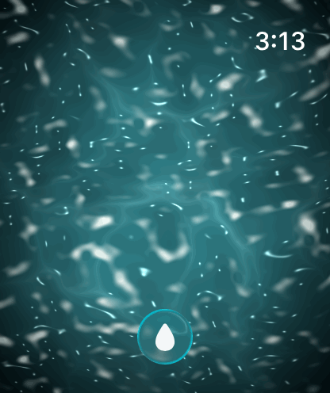

<div align="center">

# Slosh

**An ocean on your wrist.**

You are looking straight down into water. Tilt the watch and the swell rolls that
way. Shake it and the surface stirs, throws a wave in from the edge, and breaks
into foam. Tap it and a ripple spreads. Fifteen modes, each a different substance
rather than a different palette.

Apple Watch · watchOS 10+ · SwiftUI + SpriteKit

  

*Calm ocean · Breaking surf · Rain shower*

</div>

---

## What this is

A watchOS app that renders live, interactive water with a fragment shader —
refraction, caustics, sun glitter, whitecaps and spray — driven by the wrist.

The interesting engineering problem is that **watchOS gives third-party apps
almost no way to draw per-pixel**. Metal is absent, SwiftUI's shader effects are
unavailable, and `Canvas` draws shapes rather than pixels. The one route that
works is SpriteKit's `SKShader`, which accepts GLSL and compiles it to Metal
internally. Everything here follows from that discovery.

See [docs/ARCHITECTURE.md](docs/ARCHITECTURE.md) for how it works, and
[docs/DECISIONS.md](docs/DECISIONS.md) for why — including the design that was
built, rejected and thrown away.

## Future direction: Real Water

Slosh contains authored water **Experiences**. An experimental DEBUG simulator
vertical slice now adds one Real Water **Place**: San Francisco Bay, driven by
public NOAA CO-OPS water-level, wind, pressure, and current observations through
the provider-independent Hydro pipeline. This is an integration harness, not
general geographic support or a Places UI; see
[docs/REAL_WATER.md](docs/REAL_WATER.md) for coverage and provenance rules.

## Status

| | |
|---|---|
| Builds and runs on the watchOS simulator | ✅ |
| All fifteen modes render | ✅ |
| Automated checks (`swift run oceancheck`) | ✅ 340 assertions |
| **Run on physical hardware** | ❌ **never** |
| Frame rate and battery profiled | ❌ |
| Submitted to the App Store | ❌ |

Two things genuinely require a real watch and are the gate on everything else:
the tilt axis and sign, and per-pixel shader performance. Both are detailed in
[docs/ROADMAP.md](docs/ROADMAP.md#phase-0--hardware-validation).

## Quick start

```bash
git clone git@github.com:<org>/slosh.git && cd slosh
open Slosh/Slosh.xcodeproj      # then run
```

First time on this machine you will also need the watchOS platform:

```bash
xcodebuild -downloadPlatform watchOS
```

## Repository layout

```
OceanCore/                  Swift package — builds and tests without Xcode
  Sources/OceanCore/          motion, modes, Hydro domain, no UI framework
  Sources/HydroProviders/      NOAA transport and provider-local adapters
  Sources/OceanUI/             the shader, the SpriteKit scene, particles
  Sources/oceancheck/          existing water behavior checks
  Sources/hydrocheck/          deterministic Hydro translation checks
  Sources/providercheck/       offline NOAA fixtures and optional live smoke test
Slosh/                      the watchOS app
docs/                       architecture, modes, decisions, economics, roadmap
media/                      captures used by the docs
```

`OceanCore` imports no UI framework, so the physics and mode catalogue build and
run anywhere Swift does. `OceanUI` holds the shader and is shared unchanged by
watchOS, iOS and macOS.

## Testing

```bash
cd OceanCore
swift run oceancheck
swift run hydrocheck
swift run providercheck
```

The provider suite is offline by default. `swift run providercheck --live` adds
an observational, non-deterministic NOAA smoke test.

340 assertions over flow direction, surge, ripples, rain, lightning, the bowl
centre and the mode catalogue.

**Why not XCTest.** XCTest ships only inside Xcode. Writing the suite as a plain
executable means it runs anywhere the Swift toolchain does — including CI images
without Xcode, and the machine this project started on, where Xcode was present
but unusable. The harness is about eighty lines in
`OceanCore/Sources/oceancheck/Check.swift`.

Several checks exist to defend the product promise rather than the code: that
the restful modes stay restful, that a violent mode answers the wrist harder
than a calm one, and that every mode actually has the feature it exists for. A
mode whose defining feature is switched off is a recolour of another mode, and
the catalogue is tested against its own premise.

## Working without a watch

The simulator has **no motion sensors**. `SimulatedMotionProvider` stands in:
drag to tilt, flick to stir. It is compiled out on real hardware so it can never
shadow a system edge gesture.

There is also no way to script a tap, so debug launch flags exist:

```bash
xcrun simctl launch <udid> com.example.Slosh.watchkitapp -themeID aurora
xcrun simctl launch <udid> com.example.Slosh.watchkitapp -startInPicker YES
```

Both read through `@AppStorage`, so any settings key works the same way.

## If the screen is plain white

The shader failed to compile and SpriteKit fell back to the bare sprite. The
reason is always in the log:

```bash
xcrun simctl spawn <udid> log show --last 2m \
  --predicate 'processImagePath CONTAINS "Slosh"' | grep -A5 "SKShader failed"
```

Three causes, all documented in
[docs/ARCHITECTURE.md](docs/ARCHITECTURE.md#the-spritekit-shader-contract):
declaring uniforms in the shader source, using `inout` parameters, or exceeding
Metal's 31-buffer limit.

## Documentation

| Document | What it covers |
|---|---|
| [ARCHITECTURE.md](docs/ARCHITECTURE.md) | How the water is rendered and driven |
| [MODES.md](docs/MODES.md) | The fifteen modes, and how to add one |
| [DECISIONS.md](docs/DECISIONS.md) | The load-bearing calls, including the rewrite |
| [ECONOMICS.md](docs/ECONOMICS.md) | An honest look at whether this can make money |
| [ROADMAP.md](docs/ROADMAP.md) | The path from here to the App Store |
| [CONTRIBUTING.md](CONTRIBUTING.md) | Setup, conventions, review expectations |

## Licence

MIT. See [LICENSE](LICENSE).
