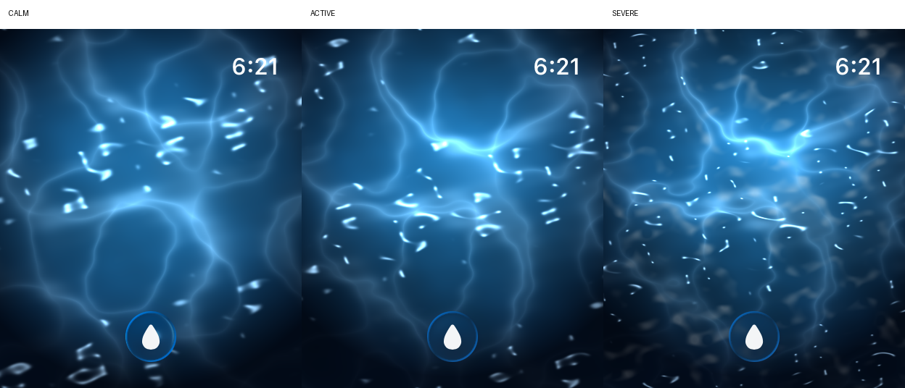
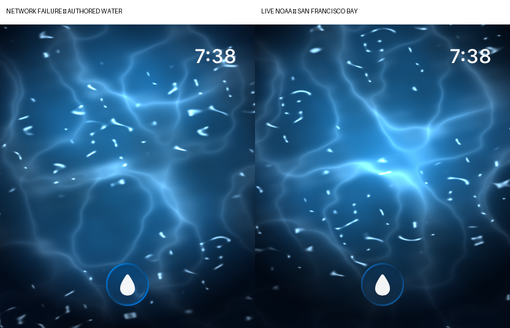

# Real Water

> **Slosh lets you wear the state of a real body of water.**

Real Water is a planned product domain. It extends Slosh without replacing the
authored experiences that already define the app.

## Two domains

- **Experiences** are the existing authored `OceanTheme` modes. They define a
  deliberate visual and behavioral character.
- **Places** are real geographic bodies of water whose accessible environmental
  measurements can persistently influence that character.

## Data boundary

Provider-specific data stops before the portable engine:

```text
Provider DTO → HydroState → HydroInterpreter → HydroExperience
```

`HydroState` retains measurement units, origin, quality, and source identity.
`HydroInterpreter` deterministically translates valid measurements into
normalized `EnvironmentalForcing` and renderer-vocabulary-only
`HydroThemeModifiers`. Provider DTOs never enter `OceanCore`.

The synthetic visual path is:

```text
HydroThemeModifiers → ResolvedWaterStyle → existing WaterScene uniforms
```

`ResolvedWaterStyle` combines an immutable authored `OceanTheme` with bounded
Hydro modifiers. `WaterScene` sends resolved choppiness, turbulence, crest
sharpness, and glitter through the existing packed `u_wave` value, and resolved
caustic strength and foaminess through `u_optics`. No shader uniform was added or
renamed. Removing Hydro modifiers restores the authored values exactly.

## Interaction and composition rule

**Environmental data is persistent forcing. Wrist movement is transient
forcing.**

`SurfaceDriver` now composes the three influences as:

- **environmental forcing = persistent baseline**;
- **wrist gravity = temporary directional authority**;
- **shake = transient surge**.

Environmental energy does not overwrite crown energy. The implemented bounded
composition is:

```text
resolvedEnergy = min(
  crownEnergy
  + 0.65 × environmentalEnergy
  + 0.15 × environmentalTurbulence
  + 0.10 × currentStrength
  + 0.10 × windStrength,
  3.0
)
```

With no environmental forcing, `resolvedEnergy` is exactly the existing crown
energy and authored behavior is unchanged. Shake surge remains separate and
decays without erasing the environmental baseline.

For direction, in-plane gravity is mapped from a dead zone of `0.12` to full
wrist authority at `0.75`. A flat watch targets the environmental current
direction. Increasing tilt blends along the shortest angular path toward the
wrist direction, and returning flat smoothly targets the environmental
direction again. Authored modes that do not follow gravity, especially Zero
Gravity, retain their authored heading behavior.

## Direction convention

Hydro directional measurements carry an explicit convention: **toward** or
**from**. `HydroInterpreter` converts both into one canonical contract:

> All `EnvironmentalForcing` directions mean the direction the force moves
> toward, in radians normalized to one full turn.

A direction without an explicit convention is unusable rather than guessed.

## Quality handling

Measurement quality affects interpretation while the source measurement remains
unchanged in `HydroState`:

```text
good    → used
unknown → used
suspect → ignored by HydroInterpreter
```

## Provenance rule

Never fabricate an unavailable measurement. Missing values remain absent rather
than becoming zero or a plausible-looking default. Product UI and future data
plumbing must clearly distinguish:

- **observed** measurements reported for a place;
- **forecast** values describing a future state;
- **predicted** values produced by an established prediction product;
- **derived** values calculated from identified inputs and a documented rule;
- **stale** state whose observation age exceeds the freshness threshold;
- **unavailable** state with no usable observation.

Freshness permits at most five minutes of future clock skew. An observation
exactly five minutes ahead is evaluated normally; one farther in the future is
`unavailable`. `SurfaceDriver` does not apply unavailable forcing. Freshness
remains deterministic because interpretation always receives a reference date.

## Observation rate is not render rate

Observation rate != simulation rate != render rate.

Environmental observations may update only every several minutes. Slosh still
simulates interaction and renders continuously between those updates. Provider
polling must never be coupled to the display loop.

## Deterministic simulator fixtures

Debug simulator builds accept `-hydroFixture calm`, `active`, or `severe`.
Each launch interprets the synthetic state with `HydroFixtures.referenceDate`
and applies both its forcing and theme modifiers to the same **Calm ocean** base
theme. Release and physical-watch builds compile the fixture path to `nil`.

Using the repository's current bundle identifier:

```bash
xcrun simctl launch <watch-udid> com.example.Slosh.watchkitapp \
  -hydroFixture calm
xcrun simctl launch <watch-udid> com.example.Slosh.watchkitapp \
  -hydroFixture active
xcrun simctl launch <watch-udid> com.example.Slosh.watchkitapp \
  -hydroFixture severe
```

These are synthetic visual-QA inputs only. They are never presented as
observations of a geographic place.



## First live provider vertical slice

RW2B implements an experimental **DEBUG watch-simulator** path for San
Francisco Bay. It proves the provider boundary without adding a general Places
interface:

```text
NOAA CO-OPS JSON
→ provider-local DTO
→ NOAAHydroAdapter
→ HydroState
→ HydroInterpreter
→ HydroExperience
→ OceanModel / WaterScene
```

`HydroProviders` is a separate Swift package target. It owns `URLSession`, NOAA
URLs, NOAA response DTOs, NOAA flags, parsing, aggregation, refresh policy, and
the in-memory last-known valid state. `OceanCore` remains network-free and owns
only provider-independent water-body and Hydro contracts. Source bindings use
opaque namespaces, identifiers, capabilities, and string parameters; provider
targets resolve only the namespaces they own and ignore all others.

### San Francisco Bay bindings

The curated `WaterBodies.sanFranciscoBay` entry uses two reviewed NOAA CO-OPS
bindings:

| Binding | Why it exists | Products used |
|---|---|---|
| San Francisco `9414290` | Active water-level and meteorological station near the Golden Gate | `water_level`, `wind`, `air_pressure` |
| Oakland Outer Harbor LB3 `s09010`, bin `2` | Active San Francisco Bay PORTS current station; NOAA identifies bin 2 as its real-time bin | `currents` |

Coverage is intentionally not uniform:

| Hydro capability | RW2B coverage |
|---|---|
| Water level | Available from `9414290` |
| Wind speed and direction | Available from `9414290` |
| Air pressure | Available from `9414290` |
| Current speed and direction | Available from separate station `s09010`, bin 2 |
| Water temperature | Unavailable: the `9414290` sensor is inactive and NOAA reports no current data |
| Salinity | Unavailable at the selected station |
| Wave height and period | Unsupported in this slice; remain `nil` |

Every request explicitly uses `date=latest`, `format=json`, `units=metric`, and
`time_zone=gmt`. Water level also uses the explicit **MLLW** (Mean Lower Low
Water) datum. NOAA metric currents are centimeters per second, so the adapter
divides by 100 before creating a `.metersPerSecond` measurement. Other selected
metric products already match the canonical Hydro units.

NOAA wind follows the meteorological **from** convention. NOAA observed currents
report where water flows **toward**. The adapter records those conventions on the
source measurements; `HydroInterpreter` still performs the one canonical
conversion into direction-toward radians.

Quality mapping is fail-closed and preserves provenance:

```text
any documented nonzero NOAA data flag → suspect
all documented flags zero            → good
missing flags or undocumented QA      → unknown
```

Preliminary (`p`) and verified (`v`) water levels are both usable when their
flags are normal. `suspect` measurements remain in `HydroState` but are ignored
by the interpreter. Missing, empty, `null`, malformed, NaN, and infinite values
remain `nil`; provider error JSON becomes a typed error and never creates fake
Hydro data.

NOAA products can have different observation times. Each provider-created
`HydroMeasurement` therefore records its own optional `observedAt`. The
aggregate state's `observedAt` is the **oldest valid product timestamp**, a
conservative freshness summary that does not claim the whole state is newer than
its least-recent component.

### Live debug launch and lifecycle

```bash
xcrun simctl launch <watch-udid> com.example.Slosh.watchkitapp \
  -realWater san-francisco-bay
```

The authored Calm ocean starts and renders before networking begins. A fetch is
attempted on activation and no more often than every **10 minutes**. In-flight
work is cancelled when the app backgrounds or the display enters reduced
luminance; no render-rate timer exists. Caching is in-memory only.

Failure behavior is explicit:

```text
success                         → cache and apply the new HydroExperience
failure with prior valid state  → preserve and reapply the prior state
failure without prior state     → preserve authored Calm ocean
```

For simulator QA, `-realWaterOffline YES` forces the unavailable path. Synthetic
`-hydroFixture` arguments take precedence over `-realWater` when both are
present, preserving deterministic fixture testing.



Implemented in RW2B: the San Francisco Bay debug vertical slice. Not implemented:
a general Places UX, automatic station discovery, historical playback, forecast
mode, persistent caching, or arbitrary geographic search.

The next provider/product step is a curated WaterBody catalog and coverage model.
USGS Water Data and NOAA ERDDAP remain future options only where they contribute
a distinct, reviewed measurement.

## Explicit non-goals of the current Real Water slices

- arbitrary geographic search;
- automatic station discovery;
- forecasting;
- persistent caching or databases;
- historical playback;
- map or general Places UI;
- server infrastructure;
- CFD simulation.

The interpreter is a deterministic perceptual translation into Slosh's existing
water vocabulary. It is not presented as literal hydrodynamics.
